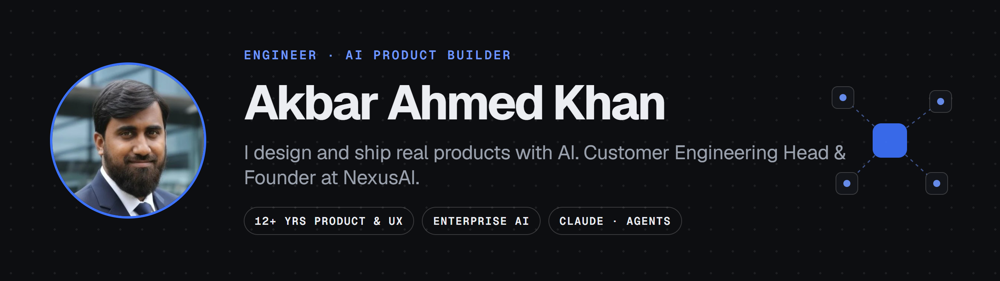

### Hi, I'm Akbar 👋

I'm an **engineer and product lead** with **12+ years in product and UX**. I design and ship real products with AI, from enterprise platforms to apps people use every day.

- 🧠 **Customer Engineering Head & Founder at [NexusAI](https://thenexusai.tech)**: an enterprise AI platform that connects a company's systems, builds a model of how the business works, and runs AI agents with people approving the risky steps, inside the company's own environment.
- 🛠️ I build with **Claude, Claude Code and AI agents**, and I share what works.
- ✍️ I post about **AI tools, product management and building with AI** on [LinkedIn](https://www.linkedin.com/in/akbar-ahmed-khan/).

---

### 🎁 Free resources

Every post I share on [LinkedIn](https://www.linkedin.com/in/akbar-ahmed-khan/) comes with its own free resource: a Claude skill, a checklist or a template. The link is in the first comment of each post.

---

### 🔭 What I work on

- **Enterprise AI**: ontologies, AI agents with guardrails, approvals and audit trails, on-premise and sovereign AI
- **Product and UX**: discovery, PRDs, prototyping, design systems, AI interfaces people can trust
- **Building with AI**: shipping products end to end with Claude Code, from prototype to production

### 🤝 Connect

[LinkedIn](https://www.linkedin.com/in/akbar-ahmed-khan/) · [X](https://x.com/Akbarkhan9) · [NexusAI](https://thenexusai.tech)
